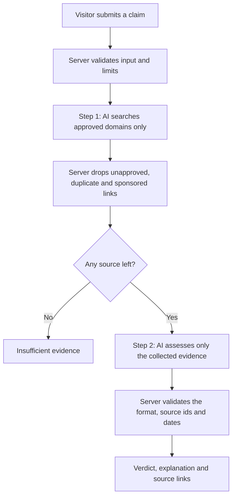

# FactCheck

**AI-assisted preliminary fact-checking in Bangla and English.**

A visitor writes a claim, the app searches a list of approved fact-checking and news websites from
Bangladesh and around the world, and an AI model compares the claim with what was found. The result
shows a verdict, a short explanation and links to the original sources.

No login, no registration and no admin panel.

> **Results are not final judgements.** The assessment can be wrong. Always read the original
> sources before sharing.

## Table of contents

- [Features](#features)
- [How it works](#how-it-works)
- [Tech stack](#tech-stack)
- [Project structure](#project-structure)
- [Getting started](#getting-started)
- [Configuration](#configuration)
- [API reference](#api-reference)
- [Approved sources](#approved-sources)
- [Testing and quality](#testing-and-quality)
- [Security, privacy and cost control](#security-privacy-and-cost-control)
- [Deployment notes](#deployment-notes)
- [Known limitations](#known-limitations)
- [Academic context](#academic-context)

## Features

| Area | What you get |
| --- | --- |
| Claim checking | Text claims up to 1,000 characters, in Bangla or English |
| Verdicts | Supported, Contradicted, Mixed / partly supported, Insufficient evidence |
| Evidence | Supporting and contradicting points with clickable inline citations |
| Sources | Fact-check reports and news reports shown separately |
| AI suggestions | Example claims suggested from recent fact-checks, with fixed examples as a fallback |
| Dashboard | Total checks, a chart by verdict and recent checks |
| History | Search, filter, delete one or all (stored in the visitor's browser) |
| Feedback | Rating and optional comment, with no name or phone number |
| Interface | Bangla and English, light theme, mobile friendly |

## How it works



Rules enforced by the server, not just requested from the model:

- A source link must come from the search **and** belong to an approved domain.
- A verdict with no evidence pointing to a retrieved source becomes **Insufficient evidence**.
- Links written by the model inside text are removed.
- For a claim about a particular day (for example "tomorrow"), only evidence about that day counts.
  Relative words are read in Bangladesh time.
- Finding nothing never means a claim is false.

## Tech stack

| Layer | Technology |
| --- | --- |
| Frontend | Next.js 16 (App Router), React 19, TypeScript, Tailwind CSS 4 |
| Backend | Node.js, Express 5, TypeScript |
| AI and search | OpenAI Responses API with the `web_search` tool and structured outputs |
| Validation | Zod |
| Storage | Browser `localStorage` for history; a local JSON Lines file for feedback |
| Quality | ESLint, Prettier, strict TypeScript, Node's built-in test runner |

There is no database.

## Project structure

```text
FactCheckerBD/
├── backend/                      Express API
│   ├── src/
│   │   ├── config/               Environment, app limits, approved sources
│   │   ├── routes/               URL to controller wiring
│   │   ├── controllers/          Request and response handling
│   │   ├── services/             Business logic: search, analysis, cache, limits, OpenAI
│   │   ├── middleware/           CORS, security headers, validation, rate limit, errors
│   │   ├── schemas/              Zod schemas
│   │   ├── utils/                Errors, URLs, dates
│   │   ├── app.ts                Express application
│   │   └── server.ts             Entry point
│   ├── scripts/smoke.ts          Optional live check against the real API
│   ├── tests/
│   └── .env.example
│
├── frontend/                     Next.js app
│   ├── src/
│   │   ├── app/                  Pages
│   │   ├── components/
│   │   │   ├── features/         claim, result, history, stats, sources, feedback, home, info
│   │   │   ├── layout/           Header, navigation, footer
│   │   │   └── ui/               Logo, icons, shared styles
│   │   ├── lib/                  API client, browser storage, translations, helpers
│   │   └── types/                API response types
│   ├── tests/
│   └── .env.example
│
└── README.md
```

### Pages

| Route | Page |
| --- | --- |
| `/` | Dashboard and claim box |
| `/result/[id]` | Result of one check |
| `/history` | Check history |
| `/sources` | Approved sources |
| `/how-it-works` | The checking process |
| `/about` | Project purpose |
| `/privacy` | Privacy policy |
| `/contact` | Feedback form |

## Getting started

### Prerequisites

- Node.js **22.9 or newer, below 25** (an LTS release is recommended) and npm
- An [OpenAI API key](https://platform.openai.com/) with billing enabled
- An internet connection (the frontend downloads Google Fonts when it builds)

### 1. Clone

```bash
git clone https://github.com/RONGONNN/FactCheckerBD.git
cd FactCheckerBD
```

### 2. Start the backend

```bash
cd backend
npm install
cp .env.example .env        # Windows PowerShell: Copy-Item .env.example .env
```

Open `backend/.env`, set `OPENAI_API_KEY`, then run:

```bash
npm run dev
```

The API listens on `http://localhost:4000`.

### 3. Start the frontend

In a second terminal:

```bash
cd frontend
npm install
cp .env.example .env.local  # Windows PowerShell: Copy-Item .env.example .env.local
npm run dev
```

Open `http://localhost:3000`.

> Copy the example files only the first time, otherwise your values are overwritten.

Without an API key the site still opens, but checking a claim answers "not available".

## Configuration

### Backend (`backend/.env`)

| Variable | Default | Purpose |
| --- | --- | --- |
| `OPENAI_API_KEY` | none | Required for checks and suggestions |
| `OPENAI_MODEL` | `gpt-5.4-mini` | Model used for all AI calls |
| `PORT` | `4000` | API port |
| `NODE_ENV` | `development` | `development`, `test` or `production` |
| `FRONTEND_ORIGIN` | `http://localhost:3000` | The only web origin allowed by CORS |
| `TRUST_PROXY_HOPS` | `0` | Reverse proxies in front of the server |
| `RATE_LIMIT_PER_HOUR` | `10` | Checks per IP address per hour |
| `DAILY_CHECK_LIMIT` | `100` | Paid checks per 24 hours, all visitors together |
| `FEEDBACK_LIMIT_PER_HOUR` | `20` | Feedback per IP address per hour |
| `CACHE_TTL_SECONDS` | `3600` | How long an identical claim reuses its result (`0` disables) |
| `FEEDBACK_FILE` | `data/feedback.jsonl` | Where feedback is appended |

### Frontend (`frontend/.env.local`)

| Variable | Default | Purpose |
| --- | --- | --- |
| `NEXT_PUBLIC_API_URL` | `http://localhost:4000` | Backend address. Visible in the browser, so never put a secret here |

## API reference

Base URL: `http://localhost:4000`. All bodies are JSON. There is no authentication.

| Method and path | Purpose |
| --- | --- |
| `GET /api/health` | Health check |
| `GET /api/sources` | Active approved sources |
| `GET /api/examples?language=bn\|en` | AI suggested example claims (may be an empty list) |
| `POST /api/check` | Check a claim |
| `POST /api/feedback` | Send feedback |

### `POST /api/check`

Request:

```json
{ "claim": "Vaccines cause autism in children.", "language": "en" }
```

`language` is `bn` (default) or `en`.

Response `200` (shortened):

```json
{
  "id": "string",
  "claim": "string",
  "verdict": "contradicted",
  "explanation": "string",
  "supporting": [],
  "contradicting": [{ "text": "string", "sourceIds": [1] }],
  "sources": [
    {
      "id": 1,
      "title": "string",
      "publisher": "string",
      "type": "factcheck",
      "url": "https://example.org/article",
      "publishedAt": null
    }
  ],
  "checkedAt": "2026-01-01T00:00:00.000Z"
}
```

`verdict` is `supported`, `contradicted`, `mixed` or `insufficient`.

### `POST /api/feedback`

```json
{ "rating": 4, "message": "optional", "checkId": "optional" }
```

`rating` is a whole number from 1 to 5. Response `201`: `{ "status": "received" }`.

### Errors

```json
{ "error": { "code": "VALIDATION_ERROR", "message": "claim must be 1 to 1000 characters." } }
```

| Code | Status |
| --- | --- |
| `VALIDATION_ERROR` | 400, 413, 415 |
| `NOT_FOUND` | 404 |
| `RATE_LIMITED` | 429, with a `Retry-After` header |
| `UPSTREAM_ERROR` | 502, 503, 504 |
| `INTERNAL_ERROR` | 500 |

## Approved sources

The list lives in `backend/src/config/sources.json`. Only these sites are searched, not the whole web.

**Fact-checkers:** Rumor Scanner, FactWatch, Dismislab, BanglaCheck, AFP Fact Check, Snopes,
PolitiFact, FactCheck.org, Full Fact, Lead Stories, Africa Check, BOOM, Alt News, Chequeado,
Maldita.es

**News:** Prothom Alo, The Daily Star, bdnews24.com, BSS, Dhaka Tribune, The Business Standard,
Reuters, Associated Press, BBC, Al Jazeera, DW, France 24, The Guardian, NPR, UN News

Each entry looks like this:

```json
{ "name": "BBC", "domain": "bbc.com", "excludePaths": ["/storyworks"], "type": "news", "active": true }
```

| Field | Meaning |
| --- | --- |
| `type` | `factcheck` or `news` |
| `active` | `false` keeps the entry but never searches it |
| `pathPrefix` | Optional: accept only pages under this path |
| `excludePaths` | Optional: reject sections such as sponsored content |

The search tool accepts at most 100 domains. FactCheckBD is listed but inactive because its domain
could not be verified. Not every listed site has been confirmed to appear in search results.

## Testing and quality

Run these in both `backend/` and `frontend/`:

| Command | Purpose |
| --- | --- |
| `npm run lint` | ESLint and Prettier check |
| `npm run format` | Apply Prettier |
| `npm run typecheck` | Strict TypeScript |
| `npm test` | Automated tests (no paid API calls) |
| `npm run build` | Production build |

An optional live check calls the real OpenAI API and **costs money**:

```bash
cd backend
npm run smoke
```

Backend tests use a fake model. The frontend tests cover logic and translations, not rendered
components.

## Security, privacy and cost control

- The API key is read only by the backend. `.env` files are ignored by Git.
- Inputs are validated on the server and request bodies are limited to 10 KB.
- CORS allows one origin, security headers are set, and error responses hide internal details.
- Claims and web pages are treated as untrusted data to reduce prompt injection.
- Claims are **sent to OpenAI** to be checked. The server does not store them.
- History stays in the visitor's browser. Feedback is stored on the server.
- Per-address and daily limits protect the budget. Suggestions are cached for 12 hours per language
  and are not counted in the daily check limit.
- Limits and caches are held in memory and reset when the server restarts, so **also set a monthly
  budget in the OpenAI dashboard**.

## Deployment notes

The app has not been deployed yet.

| Part | Root directory | Build | Start |
| --- | --- | --- | --- |
| Backend (any Node host) | `backend` | `npm ci --include=dev && npm run build` | `npm start` |
| Frontend (for example Vercel) | `frontend` | `npm run build` | `npm start` |

### Backend on Vercel

Create a separate Vercel project with `backend` as the root directory. [`backend/index.ts`](backend/index.ts)
is the entry point.

- Set `OPENAI_API_KEY` and `FRONTEND_ORIGIN` (the frontend's URL). `OPENAI_MODEL` and the limits are
  optional. `PORT` and `FEEDBACK_FILE` are not used there.
- Feedback is written to the runtime logs, not to a file, and Vercel keeps those only for a limited
  time. Add a database store before relying on it.
- Rate limits and caches are per running instance, so they are weaker than on a single server. Set a
  monthly budget in the OpenAI dashboard.

### All hosts

- Set `FRONTEND_ORIGIN` on the backend and `NEXT_PUBLIC_API_URL` on the frontend (before building).
- Behind a proxy, set `TRUST_PROXY_HOPS` and test that the rate limit separates visitors.
- On hosts with a temporary file system, the feedback file is lost on restart. Use a persistent disk
  or implement the `FeedbackStore` interface with a database.

## Known limitations

- Text claims only: no image, video or URL checking.
- The AI reads search summaries, not full articles, and can be wrong.
- The same claim can get a different result at another time, because search results change.
- Publication dates are not reported.
- AI suggestions follow written safety instructions but are not reviewed by a person.
- Only a few claims have been tried against the real API. No accuracy figure has been measured.

## Academic context

An academic software project of the Department of Software Engineering, Daffodil International
University, connected to the thesis *"The Impact of Social Media Rumors on Bangladeshi Social Media
Users: A Survey-Based Study on Trust, Information Verification, and User Behavior"*.

External source content belongs to its publisher. The app links to articles and does not republish
them.
